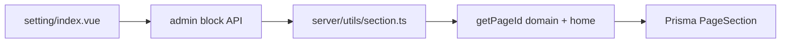
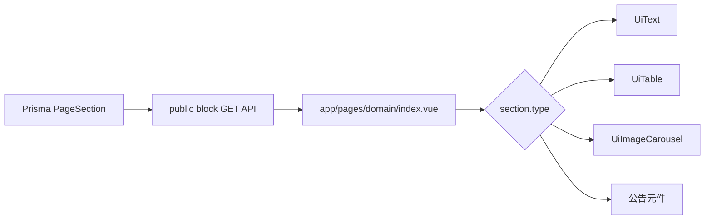

# 新增首頁資料區塊實作指南

本指南用來完成首頁區塊管理功能，涵蓋新增、編輯、排序、啟用／停用、刪除、儲存，以及前台依區塊類型渲染。本文不要求新增資料表，也不涵蓋第五種區塊類型。

## 1. 閱讀前說明

- 架構分析以 `graphify-out` 為導航，再以目前工作樹的程式碼為準。
- `graphify-out/GRAPH_REPORT.md` 建於 commit `5cbe59b2`，目前檢查時的 HEAD 是 `15b58fd`，圖譜已落後首頁區塊相關的未提交變更。
- 本次環境沒有獨立的 codegraph 工具，因此本文不宣稱使用 codegraph 的查詢結果。
- graphify 顯示本專案沒有 import cycle；首頁區塊的主要跨層連線集中在 `getPageId()`、`getSectionByPageId()`、`insertSection()` 與 `updateSection()`。

## 2. 整體架構與資料流

### 各層責任

| 層級 | 主要位置 | 責任 |
| --- | --- | --- |
| 管理頁 | `app/pages/[domain]/setting/index.vue` | 載入區塊、呈現編輯器、觸發 CRUD 與排序 |
| 前台首頁 | `app/pages/[domain]/index.vue` | 取得已啟用區塊並依類型渲染 |
| UI 元件 | `app/components/ui/` | 編輯或顯示文字、表格、輪播圖與公告 |
| 共享契約 | `app/shared/types/page-section.ts` | 定義區塊類型、body 結構與 PageSection 資料形狀 |
| 預設資料 | `app/shared/constants/page-section-defaults.ts` | 建立各區塊的新資料預設值 |
| UI registry | `app/constants/page-section-ui-registry.ts` | 集中維護 type、顯示名稱與預設 body 的對應 |
| 管理 API | `server/api/page/admin/` | 驗證登入並處理區塊 CRUD |
| 公開 API | `server/api/page/[domain]/[slug]/block.get.ts` | 僅回傳可公開顯示的區塊 |
| Server utility | `server/utils/section.ts`、`server/utils/page.ts` | 查找頁面 ID 並封裝 Prisma 操作 |
| 資料庫 | `prisma/schema.prisma` 的 `PageSection` | 儲存 type、title、JSON body、順序及啟用狀態 |

### 管理端寫入流程



### 前台讀取流程



`getSectionByPageId(domain, slug, enabled)` 先呼叫 `getPageId()`，再依 `sortOrder` 查詢區塊。管理端不傳 enabled，可看到全部資料；公開 API 傳入 `true`，只取得啟用資料。

## 3. 實作前盤點

正式區塊類型以共享型別與 registry 為準：

| type | 中文名稱 | body 型別 |
| --- | --- | --- |
| `richText` | 文字區塊 | `RichTextBody` |
| `table` | 表格 | `TableBody` |
| `carousel` | 輪播圖 | `CarouselBody` |
| `announcement` | 公告 | `AnnouncementBody` |

開始前先確認以下落差：

1. 管理頁的本地清單仍使用 `text` 與 `banner`，但共享契約使用 `richText` 與 `announcement`。後續只能保留 registry 的四種正式值。
2. Prisma 將 `bodyJson` 定義為 `Json?`；前端目前的本地 interface 卻是 `string | null`。應改為對應 type 的物件，不要重複 `JSON.stringify()`。
3. 管理頁目前用 `Date.now()` 產生假 ID，只更新本地陣列。正式流程必須先 POST，再使用伺服器回傳的資料。
4. delete endpoint 目前呼叫 `getSectionByPageId(id)`，參數也不符合函式介面，實際上不會刪除資料。
5. `UiTable` 與 `UiImageCarousel` 仍是占位狀態；前台首頁也只直接輸出 `bodyJson`，尚未完成分派渲染。
6. `insertSection()` 與 `updateSection()` 直接接受 `any`，且會把 request body 展開給 Prisma。實作 CRUD 時必須同步加入白名單與驗證。

## 4. 建議資料契約

先在共享型別中建立唯一的資料來源。實際命名可以沿用專案風格，但至少要表達以下契約：

```ts
type PageSectionBodyMap = {
  richText: RichTextBody
  table: TableBody
  carousel: CarouselBody
  announcement: AnnouncementBody
}

type PageSection<T extends PageSectionType = PageSectionType> = {
  id: number
  pageId: number
  type: T
  title: string | null
  bodyJson: PageSectionBodyMap[T]
  sortOrder: number
  isEnabled: boolean
  createdAt?: string
  updatedAt?: string
}
```

建立區塊時不應送出 `id`、`pageId`、`createdAt` 或 `updatedAt`。建議新增 payload 為：

```ts
type CreatePageSectionPayload<T extends PageSectionType = PageSectionType> = {
  type: T
  title: string | null
  bodyJson: PageSectionBodyMap[T]
  sortOrder: number
  isEnabled: boolean
}
```

更新 payload 只允許 `title`、`bodyJson`、`sortOrder`、`isEnabled`；區塊 type 建立後先視為不可變，避免既有 body 與新 type 不相容。

## 5. 循序實作

### 步驟一：統一共享型別

**修改位置**

- `app/shared/types/page-section.ts`
- 所有仍宣告本地 `PageSection` interface 的首頁頁面

**要做的事**

1. 加入 `PageSectionBodyMap`、`PageSection`、create/update payload 型別。
2. 將 `Boolean` 改成 primitive `boolean`。
3. 移除管理頁與前台首頁內重複的 interface，改用共享型別。
4. 確保 `bodyJson` 是物件，而不是 JSON 字串。

**預期資料**

```json
{
  "id": 12,
  "pageId": 3,
  "type": "richText",
  "title": "關於我們",
  "bodyJson": {
    "contentHtml": "<p>首頁文字</p>",
    "textAlign": "left",
    "maxWidth": "960px"
  },
  "sortOrder": 0,
  "isEnabled": true
}
```

**驗證方式**

- TypeScript 能根據 type 約束 body 欄位。
- 首頁頁面不再存在第二份 `PageSection` 定義。

**常見錯誤**

- 從 API 收到物件後再次 `JSON.parse()`。
- 使用 `Boolean` 包裝型別，造成條件判斷或型別推導不一致。

### 步驟二：由 registry 建立新增選單

**修改位置**

- `app/constants/page-section-ui-registry.ts`
- `app/pages/[domain]/setting/index.vue`

**要做的事**

1. 從 `pageSectionRegistry` 取得 entries，產生四個新增按鈕。
2. 移除頁面內的 `sectionType` 與 `InsertData`。
3. 點擊按鈕時，以 registry 的 `createDefaultBody()` 建立 create payload。
4. `sortOrder` 使用目前最大值加一；沒有資料時從 0 開始。
5. 送出 POST，成功後把 response 加到清單；失敗時不建立假資料。

**API**

```http
POST /api/page/admin/:domain/home/block
Content-Type: application/json
```

```json
{
  "type": "table",
  "title": null,
  "bodyJson": {
    "columns": [
      { "key": "column1", "label": "欄位一" },
      { "key": "column2", "label": "欄位二" }
    ],
    "rows": [{ "column1": "", "column2": "" }],
    "striped": true,
    "bordered": true
  },
  "sortOrder": 1,
  "isEnabled": true
}
```

成功回傳完整 `PageSection`，HTTP status 建議為 `201`。未登入回傳 `401`；domain 或 home page 不存在回傳 `404`；payload 不合法回傳 `400` 或 `422`。

**驗證方式**

- 四種按鈕的 label 與 registry 一致。
- 新增後取得資料庫正式 ID，重新整理仍看得到。
- 快速連點時按鈕進入 loading／disabled，避免重複新增。

**常見錯誤**

- 用陣列 index 當永久排序或 Vue key。
- 前端新增成功，但忽略伺服器回傳內容而繼續使用假 ID。

### 步驟三：補齊管理 API 驗證

**修改位置**

- `server/api/page/admin/[domain]/[slug]/block.post.ts`
- `server/api/page/admin/[id]/block.put.ts`
- `server/utils/section.ts`

**要做的事**

1. 確認 `readBody()` 結果是物件；現在 POST endpoint 建立 error 後沒有 `throw`，需一併修正。
2. type 只能是四種 registry 契約值。server 不宜直接 import UI registry，可將合法 type 定義放在 shared 層供雙方使用。
3. 依 type 驗證 `bodyJson` 的必要欄位與基本型別。
4. 僅挑出允許寫入的欄位，不把完整 body 直接 spread 給 Prisma。
5. `insertSection()` 必須先取得 pageId；pageId 為 null 時停止並回傳 404，不可交給 Prisma 製造不明確錯誤。
6. update 前確認 section 存在；禁止透過 body 修改 id、pageId、createdAt 或 updatedAt。

**更新 API**

```http
PUT /api/page/admin/:id/block
Content-Type: application/json
```

```json
{
  "title": "最新公告",
  "bodyJson": {
    "limit": 5,
    "showDate": true,
    "showMoreButton": true
  },
  "sortOrder": 2,
  "isEnabled": true
}
```

成功回傳更新後的完整 `PageSection`。不存在的 id 回傳 `404`，無效 id 或 payload 回傳 `400`／`422`。

**驗證方式**

- 手動送出額外的 `pageId` 或 `createdAt`，確認不會被寫入。
- 送出未知 type、錯誤 body、無效 ID，確認回傳可預期的 4xx。

**常見錯誤**

- 只在前端驗證，讓直接呼叫 API 時可以寫入任意資料。
- 把 Prisma not-found exception 原樣變成 500。

### 步驟四：建立四種編輯介面

**修改位置**

- `app/pages/[domain]/setting/index.vue`
- `app/components/ui/Text.vue`、`Table.vue`、`ImageCarousel.vue`
- 公告編輯／顯示元件（沿用 UI 元件目錄命名規則）

**要做的事**

1. 每張區塊卡片提供 title、啟用狀態、上移、下移、儲存與刪除操作。
2. `richText` 編輯 `contentHtml`、`textAlign`、`maxWidth`；CKEditor 的 domain 由 props 傳入。
3. `table` 可新增／刪除欄與列、編輯 label 和儲存格，並設定 striped、bordered。
4. `carousel` 補齊圖片資料契約後，編輯圖片、播放間隔、箭頭與圓點。若現階段尚無圖片上傳契約，先明確顯示空狀態，不要送出元件 props 中未被共享型別定義的欄位。
5. `announcement` 編輯 limit、showDate、showMoreButton；資料來源若尚未存在，只呈現設定與空狀態。
6. 使用 local draft 編輯；按儲存後才 PUT。成功後以 response 替換該筆資料，失敗時保留草稿並顯示錯誤。

**驗證方式**

- 四種 body 都能編輯並持久化。
- 一筆儲存中不會阻止其他區塊閱讀，但同一筆不能重複送出。
- API 失敗時不會把畫面誤標為已儲存。

**常見錯誤**

- 子元件直接修改 props；應使用 `v-model` 契約或 emit 更新後的 body。
- 多個 CKEditor 共用同一個 `editorData`，導致內容互相覆蓋。

### 步驟五：排序與啟用狀態

**要做的事**

1. 上移／下移後，以陣列目前順序重新指定連續的 `sortOrder`（0、1、2……）。
2. 依序對受影響區塊呼叫既有 PUT API；全部成功才顯示排序完成。
3. 任一請求失敗時重新 GET 伺服器資料，避免本地順序與資料庫永久分歧。
4. 啟用切換也透過 PUT 儲存；公開 API 本來就以 `isEnabled=true` 過濾。

**驗證方式**

- 排序後重新整理，順序不變。
- 停用後管理頁仍看得到，前台看不到；重新啟用後恢復顯示。

**常見錯誤**

- 只交換本地陣列，沒有持久化 sortOrder。
- `Promise.all()` 部分成功時仍顯示全部成功；若使用平行請求，必須處理部分失敗並重新載入。

### 步驟六：實作真正刪除

**修改位置**

- `server/utils/section.ts`
- `server/api/page/admin/[id]/block.delete.ts`
- 管理頁刪除操作

**要做的事**

1. 新增 `deleteSection(sectionId)`，驗證正整數 ID、確認資料存在，再呼叫 `prisma.pageSection.delete()`。
2. delete endpoint 改呼叫該 utility，不再誤用 `getSectionByPageId()`。
3. API 成功可回傳被刪除的 section，或採 `204 No Content`；本專案若沒有統一規範，建議回傳被刪除資料以利管理頁確認 ID。
4. 管理頁先要求確認，成功後才從清單移除，接著重新編號並儲存其餘 sortOrder。

```http
DELETE /api/page/admin/:id/block
```

**驗證方式**

- 刪除後重新整理不再出現，前台同步消失。
- 不存在的 ID 回傳 404；未登入回傳 401。

**常見錯誤**

- API 尚未成功就先永久移除本地資料。
- 刪除中允許重複點擊。

### 步驟七：完成前台渲染

**修改位置**

- `app/pages/[domain]/index.vue`
- 各 UI 顯示元件

**要做的事**

1. 保留 `GET /api/page/:domain/home/block`，此 API 已傳 `true` 給 `getSectionByPageId()`，只回傳啟用資料。
2. 依 `section.type` 對應顯示元件，傳入已定型的 `bodyJson`。
3. `richText` 顯示 HTML 前必須確認內容信任邊界；若管理員輸入仍可能包含危險 HTML，加入 server-side sanitization 後才使用 `v-html`。
4. 未知 type 不讓整頁崩潰：開發環境顯示提示，正式畫面略過並記錄錯誤。
5. 加入 loading、empty、fetch error 三種狀態。

**驗證方式**

- 四種區塊依 sortOrder 顯示。
- 停用與未知 type 不會破壞首頁。
- domain 或 home page 不存在時顯示合理錯誤，而不是空白頁。

**常見錯誤**

- 把 `bodyJson` 當純文字輸出。
- 未處理富文字 HTML 的 XSS 風險。

## 6. API 契約總表

| Method | Path | 用途 | Auth | 成功回傳 |
| --- | --- | --- | --- | --- |
| GET | `/api/page/admin/:domain/home/block` | 管理端取得全部區塊 | 必須 | `PageSection[]` |
| POST | `/api/page/admin/:domain/home/block` | 新增區塊 | 必須 | 新增後的 `PageSection` |
| PUT | `/api/page/admin/:id/block` | 更新內容、順序或啟用狀態 | 必須 | 更新後的 `PageSection` |
| DELETE | `/api/page/admin/:id/block` | 刪除區塊 | 必須 | 被刪除的 `PageSection`（建議） |
| GET | `/api/page/:domain/home/block` | 前台取得已啟用區塊 | 不需要 | `PageSection[]` |

所有管理 API 應使用一致錯誤語意：

- `400 Bad Request`：path ID 格式錯誤、body 缺失或格式錯誤。
- `401 Unauthorized`：沒有有效登入狀態。
- `404 Not Found`：site、home page 或 section 不存在。
- `422 Unprocessable Entity`：type 或 body 結構不符合契約；若專案不區分 400／422，可統一為 400，但須保持一致。

## 7. 驗收清單

### 自動檢查

專案目前沒有獨立的 typecheck 或 test script，因此至少執行：

```bash
npm run lint
npm run build
```

不要使用 `npm run lint:fix` 作為單純驗證，因為它會改寫檔案。若之後加入測試，優先覆蓋 shared payload validation 與 section utilities。

### API 情境

- [ ] 未登入呼叫四個管理 API 都得到 401。
- [ ] 無效 domain／不存在的 home page 得到 404。
- [ ] 無效 section ID 得到 400，不存在的 section 得到 404。
- [ ] 未知 type、錯誤 body 結構、額外受保護欄位不會寫入資料庫。
- [ ] 公開 GET 永遠不回傳 `isEnabled=false` 的區塊。
- [ ] GET 結果依 `sortOrder` 升冪排列。

### 瀏覽器端到端情境

- [ ] 分別新增 richText、table、carousel、announcement，重新整理後資料仍存在。
- [ ] 修改每一種 body 並儲存，重新整理後內容一致。
- [ ] 上移／下移後，管理頁與前台順序一致。
- [ ] 停用後管理頁仍可編輯，前台不顯示；重新啟用後恢復。
- [ ] 刪除後管理頁、前台與重新整理結果都不再出現。
- [ ] loading、空清單、儲存中與 API 失敗都有清楚狀態。
- [ ] 未知 type 或單一區塊資料錯誤不會造成整個首頁失效。

完成以上項目後，首頁區塊管理才算具備可持久化、可維護且前後台契約一致的完整流程。
